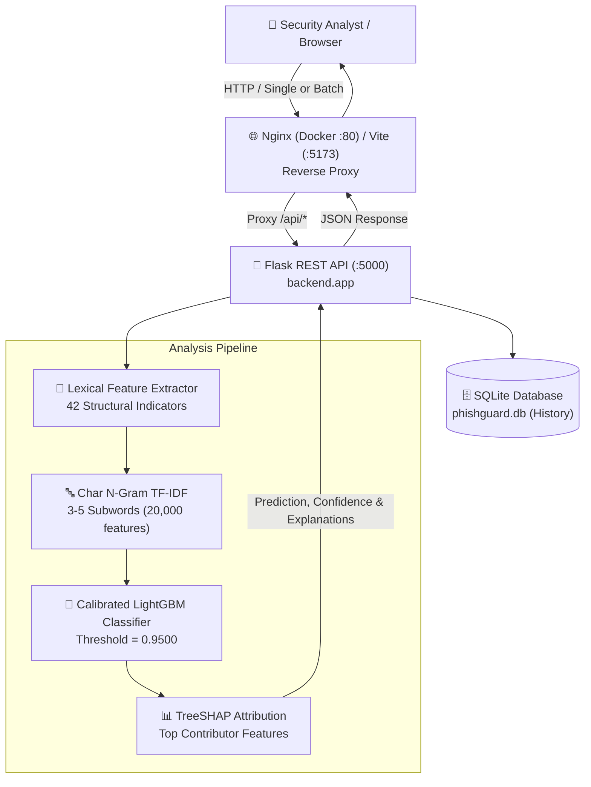

# PhishGuard AI — Phishing Website Detection System

<div align="center">


[](https://github.com/nandanrupesh739/Phishing-Website-Detection/actions/workflows/ci.yml)


**An honest, production-hardened machine learning system detecting phishing URLs purely from static URL structure and character subwords — without network visits, DNS queries, or page downloads.**

[Quick Start](#quick-start) · [Docker](#docker-quick-start) · [Screenshots](#application-screenshots) · [Architecture](#architecture) · [Model Methodology](#how-the-model-works) · [Results](#benchmark-results) · [API](#api-overview) · [Limitations](#honest-limitations--threat-model)

</div>

> ⚠️ **Educational & Research Notice**:  
> PhishGuard AI is an **educational research system**. All classifications are based strictly on **static URL-string lexical metrics and character subwords** without fetching page contents, inspecting TLS certificates, or executing JavaScript. Predictions must not be the sole basis for security decisions.

---

## Table of Contents

- [Overview](#overview)
- [Application Screenshots](#application-screenshots)
- [Key Features](#key-features)
- [Architecture](#architecture)
- [Quick Start](#quick-start)
- [Docker Quick Start](#docker-quick-start)
- [API Overview](#api-overview)
- [Configuration](#configuration)
- [Project Structure](#project-structure)
- [How the Model Works](#how-the-model-works)
  - [Lexical Features (42)](#lexical-features-42)
  - [Character N-Gram TF-IDF Subwords](#character-n-gram-tf-idf-subwords)
  - [Model Comparison](#model-comparison)
  - [Domain-Grouped Split](#domain-grouped-split)
  - [Calibration and Threshold Tuning](#calibration-and-threshold-tuning)
- [Benchmark Results](#benchmark-results)
- [External Evaluation](#external-evaluation)
- [Honest Limitations & Threat Model](#honest-limitations--threat-model)
- [Testing & Quality Tooling](#testing--quality-tooling)
- [Security & Privacy Notes](#security--privacy-notes)
- [Roadmap](#roadmap)
- [License](#license)
- [Dataset Citation & Credits](#dataset-citation--credits)

---

## Overview

PhishGuard AI is an end-to-end phishing URL analysis and detection platform. It is engineered with a strict **zero-network policy**: URLs submitted for analysis are treated solely as offline plain text strings and are never fetched, connected to, or resolved over the Internet. The system combines **42 handcrafted structural lexical features** with **20,000 character 3–5-gram TF-IDF subwords**, feeding into a probability-calibrated LightGBM gradient boosted decision tree classifier tuned for near-zero false positives.

---

## Application Screenshots

### Security Analyst Web Interface

| Dashboard & Threat Telemetry | Real-Time URL Scanner & TreeSHAP |
| :---: | :---: |
|  |  |

| Batch Queue CSV Scanner | Historical Scan Logs |
| :---: | :---: |
|  |  |

| Model Performance & Metrics | Feature Attribution Auditing |
| :---: | :---: |
|  |  |

### Model Evaluation Curves

| Confusion Matrix (Zero False Positives) | ROC Curve (AUC = 0.9980) |
| :---: | :---: |
|  |  |

| Probability Calibration Reliability Curve | Feature Importances (Top Features) |
| :---: | :---: |
|  |  |

---

## Key Features

- **Zero-Network Static Safety**: Pure offline analysis. Zero outbound HTTP requests, zero DNS resolutions, zero WHOIS lookups.
- **70/15/15 Domain-Grouped Split**: Split strictly by registered domain (`tldextract`) — zero domain leakage between training, validation, and test partitions.
- **Probability Calibration & Tuned Threshold**: Calibrated via `CalibratedClassifierCV(method="sigmoid", cv=3)` (Platt scaling). Decision threshold set to `0.9500`, achieving $\ge 98\%$ recall with **zero false positives** on the held-out test split.
- **Explainable TreeSHAP Contributions**: Local feature attributions calculated at inference time via TreeSHAP showing exactly which structural patterns increased or decreased risk.
- **Safe Batch Scanner**: Process up to 100 URLs per request or upload CSV/TXT files with automated CSV formula injection protection (CWE-1236).
- **Hardenened REST API**: IP-based rate limiting (60 req/min), strict port and IP validation, security headers (`nosniff`, `DENY`, CSP), and admin API key protection on history deletion.
- **Privacy Mode**: Optional SHA-256 URL hashing (`ANONYMIZE_URLS=true`) to scrub raw sensitive query parameters from logs and databases.

---

## Architecture



---

## Quick Start

### Prerequisites
- Python 3.11, 3.12, or 3.14
- Node.js 20+ and npm

### 1. Set Up Backend Virtual Environment
```bash
# Clone the repository
git clone https://github.com/nandanrupesh739/Phishing-Website-Detection.git
cd Phishing-Website-Detection

# Create virtual environment and activate
python -m venv .venv

# On Linux / macOS:
source .venv/bin/activate
# On Windows (PowerShell):
.venv\Scripts\Activate.ps1

# Install runtime and development dependencies
pip install -r requirements.txt -r requirements-dev.txt
```

### 2. Download Dataset & Train the Model
```bash
# Download official UCI PhiUSIIL dataset into data/
python download_data.py

# Execute model training pipeline (generates model binaries & evaluation plots)
python train.py

# Export documentation assets
python scripts/export_docs_assets.py
```

### 3. Start Flask Backend
```bash
python -m backend.app
# Backend runs at http://127.0.0.1:5000
```

### 4. Start React Frontend
In a new terminal:
```bash
cd frontend
npm install
npm run dev
# Frontend runs at http://localhost:5173
```

---

## Docker Quick Start

> **Note**: The machine learning model must be trained before launching the application container, or trained via a one-off compose command, because model binaries are mounted from the host and not baked into the image.

### 1. Train Model on Host or via Compose
```bash
# Host option:
python download_data.py && python train.py

# Or one-off container command:
docker compose run --rm backend python train.py
```

### 2. Start Application Stack
```bash
docker compose up --build
```

- **Frontend**: Accessible at `http://localhost:5173` (or port configured in `.env`).
- **Backend API**: Accessible at `http://localhost:5173/api/` (reverse-proxied via Nginx). The backend container is isolated on the internal bridge network and does not publish port 5000 directly to the host.

---

## API Overview

Full REST API documentation is available in [`docs/api.md`](docs/api.md).

| Method | Endpoint | Description | Rate Limit |
| :--- | :--- | :--- | :--- |
| `GET` | `/api/health` | Service health, model status, feature count, DB connectivity | None |
| `POST` | `/api/predict` | Classify single URL; returns confidence, score, TreeSHAP attributions | 60/min |
| `POST` | `/api/predict-batch` | Classify list of URLs (max 100); preserves input ordering | 60/min |
| `GET` | `/api/history` | Paginated scan history logs and aggregate threat statistics | None |
| `DELETE` | `/api/history` | Clear scan history (Requires `X-Admin-Key` header) | None |
| `GET` | `/api/model-metrics` | Model comparison, test set metrics, calibration stats | None |
| `GET` | `/api/model-info` | Metadata including trained algorithm, date, and feature list | None |
| `GET` | `/api/features` | Returns array of the 42 extracted lexical feature names | None |

---

## Configuration

PhishGuard AI is configured via environment variables. Create a `.env` file from `.env.example`:

| Variable | Default Value | Description |
| :--- | :--- | :--- |
| `FLASK_HOST` | `127.0.0.1` | Host interface for Flask server (`0.0.0.0` inside Docker) |
| `FLASK_PORT` | `5000` | Port for Flask backend |
| `FLASK_DEBUG` | `false` | Enable Flask debug mode (must be `false` in production) |
| `SECRET_KEY` | *(Random 32-char hex)* | Flask session secret key |
| `ADMIN_API_KEY` | `dev-admin-key-change-in-production` | Secret required in `X-Admin-Key` header for `DELETE /api/history` |
| `CORS_ALLOWED_ORIGINS` | `http://localhost:5173,...` | Comma-separated list of permitted CORS origins |
| `DATABASE_PATH` | `phishguard.db` | Path to SQLite database file |
| `MODEL_PATH` | `models/phishguard_model.joblib` | Primary model bundle path (`joblib`) |
| `MODEL_PKL_PATH` | `models/model.pkl` | Fallback model bundle path (`pickle`) |
| `METRICS_PATH` | `models/model_metrics.json` | Path to training metrics JSON |
| `RATE_LIMIT_PREDICT` | `60 per minute` | Rate limit string for `/api/predict` endpoints |
| `MAX_BATCH_SIZE` | `100` | Maximum URLs accepted in a single batch scan |
| `MAX_CONTENT_LENGTH` | `1048576` | Maximum request payload size in bytes (1 MB) |
| `ANONYMIZE_URLS` | `false` | When `true`, URLs are hashed with SHA-256 before storage |
| `FRONTEND_PORT` | `5173` | Host port mapped to frontend container in Docker Compose |

---

## Project Structure

```
Phishing-Website-Detection/
├── .github/
│   └── workflows/
│       └── ci.yml                 # GitHub Actions CI matrix (Py 3.11/3.12 + Node 20)
├── backend/
│   ├── tests/                     # 168 pytest test cases (96% line coverage)
│   ├── __init__.py
│   ├── app.py                     # Flask REST API with security headers & rate limits
│   ├── config.py                  # Pydantic/dataclass configuration and environment parser
│   ├── database.py                # SQLite scan history database with migration support
│   ├── features.py                # 42 lexical URL feature extractors
│   ├── predictor.py               # Inference engine with TreeSHAP and Platt scaling
│   └── train_model.py             # Reusable training pipeline helper
├── docs/
│   ├── images/                    # Tracked README screenshots and evaluation plots
│   ├── api.md                     # Comprehensive REST API reference
│   └── metrics.json               # Canonical evaluation results from training run
├── frontend/
│   ├── src/
│   │   ├── components/            # UI components (Scanner, Charts, Skeleton, Modal)
│   │   ├── pages/                 # Dashboard, Scanner, ScanHistory, Performance, About
│   │   ├── services/              # Axios API client layer with health polling
│   │   ├── test/                  # Vitest test suite (Smoke, Unit, Error boundaries)
│   │   └── types/                 # TypeScript interfaces aligned with backend schema
│   ├── Dockerfile                 # Multi-stage build (Node 20 -> Nginx Alpine)
│   ├── nginx.conf                 # Nginx SPA router and reverse proxy configuration
│   └── package.json
├── reports/                       # Working training evaluation plots and reports
├── scripts/
│   ├── e2e_smoke.py               # In-process Flask live HTTP smoke test
│   ├── export_docs_assets.py      # Doc asset synchronization utility
│   ├── external_eval.py           # Out-of-distribution evaluation runner
│   └── error_analysis.py          # False-positive / False-negative diagnostics
├── .dockerignore
├── .gitignore
├── .pre-commit-config.yaml        # Ruff and code hygiene pre-commit hooks
├── CONTRIBUTING.md
├── docker-compose.yml
├── Dockerfile                     # Root backend container file
├── download_data.py               # UCI PhiUSIIL dataset downloader
├── LICENSE                        # MIT License
├── Makefile                       # Developer automation task targets
├── pyproject.toml                 # Ruff and Mypy tool configuration
├── requirements.txt               # Pinned runtime dependencies
├── requirements-dev.txt           # Pinned test and developer dependencies
├── SECURITY.md                    # Security policy, scope, and pickle trust advisory
└── train.py                       # Main ML pipeline: feature extraction & model training
```

---

## How the Model Works

### Lexical Features (42)

The feature extractor ([`backend/features.py`](backend/features.py)) extracts 42 numerical and boolean features from the raw URL string without network interaction:

1. **Length Metrics**: `url_length`, `hostname_length`, `path_length`.
2. **Structural Tokens**: `num_dots`, `num_hyphens`, `num_subdomains`, `path_depth`, `longest_token_length`.
3. **Character Distributions**: `num_digits`, `digit_ratio`, `vowel_consonant_ratio`, `domain_vowel_ratio`, `digit_to_letter_ratio`.
4. **Entropy & Obfuscation**: `hostname_entropy`, `num_percent_encoded`, `has_unusual_encoding`, `has_repeated_separators`.
5. **Brand Spoofing & Phishing Indicators**: `has_brand_impersonation` (checks PayPal, Google, Apple, Microsoft, Amazon, Netflix, Wells Fargo, Chase, and banking keywords embedded into subdomains or paths of unassociated domains), `brand_in_wrong_place`, `has_suspicious_terms`.
6. **Network & Protocol Semantics**: `has_ip_hostname`, `has_ip_in_path`, `has_non_default_port`, `has_https`, `scheme_missing`.
7. **TLD Semantics**: `has_suspicious_tld`, `tld_frequency`, `domain_digit_count`, `domain_hyphen_count`.
8. **Special Tokens**: `has_at_symbol`, `has_at_before_host`, `has_at_in_path`, `has_double_extension`, `has_double_slash_in_path`, `has_punycode`, `is_url_shortener`.

### Character N-Gram TF-IDF Subwords
In addition to tabular features, a `TfidfVectorizer` extracts character 3-gram to 5-gram subwords (`min_df=5`, `max_features=20000`). This captures obfuscated lexical signatures, phonetic tricks, and phishing keyword stems directly from URL text.

### Model Comparison
Four model architectures were evaluated using 5-fold cross-validation on the training set:

| Architecture | Features | CV F1-Score | Validation ROC-AUC |
| :--- | :--- | :---: | :---: |
| **LightGBM (Winner)** | **42 Tabular + 20k TF-IDF** | **0.9951 ± 0.0013** | **0.9985** |
| Random Forest | 42 Tabular | 0.9953 ± 0.0006 | 0.9979 |
| Logistic Regression | 42 Tabular + 20k TF-IDF | 0.9905 ± 0.0035 | 0.9989 |
| Multinomial Naive Bayes | 20k TF-IDF Subwords | 0.9672 ± 0.0149 | 0.9952 |

### Domain-Grouped Split
Standard random train/test splits cause severe data leakage because benign domains (such as `wikipedia.org` or `cnn.com`) appear thousands of times across the dataset. PhishGuard AI enforces a **70/15/15 Domain-Grouped Split** using `GroupKFold` / `GroupShuffleSplit` on the registered domain extracted via `tldextract`. **Zero registered domains overlap** between the training (164,759 URLs), validation (35,144 URLs), and test (34,177 URLs) splits.

### Calibration and Threshold Tuning
1. **Probability Calibration**: LightGBM raw leaf scores are calibrated via `CalibratedClassifierCV(method="sigmoid", cv=3)` (Platt scaling) so returned scores represent true empirical probabilities. Brier score on the test set is **0.0042**.
2. **Threshold Tuning**: The decision threshold was tuned on the validation set targeting $\ge 98\%$ recall with **zero false positives** ($\text{FPR} = 0.0$). The resulting decision threshold is **0.9500**. Any URL with calibrated phishing probability $\ge 0.9500$ is flagged as `PHISHING`.

---

## Benchmark Results

All metrics below are verified directly from [`docs/metrics.json`](docs/metrics.json) evaluated on the held-out test split (34,177 unseen URLs across completely unseen domains):

| Metric | Held-Out Test Set Value |
| :--- | :--- |
| **Accuracy** | **0.9934** (99.34%) |
| **Precision** | **1.0000** (100.0%) |
| **Recall** | **0.9839** (98.39%) |
| **F1-Score** | **0.9919** (99.19%) |
| **ROC-AUC** | **0.9980** |
| **Average Precision (PR-AUC)** | **0.9983** |
| **Brier Score** | **0.0042** |
| **False Positive Rate (FPR)** | **0.0000** (0.0%) |
| **Decision Threshold** | **0.9500** |

### Test Split Confusion Matrix

```
                      Predicted Benign (SAFE)    Predicted Phishing (PHISHING)
Actual Benign (0):             20,115                                0   (0 FP)
Actual Phishing (1):              227                           13,835
```

- **True Negatives**: 20,115 benign URLs correctly identified.
- **False Positives**: **0** false alarms out of 20,115 benign URLs.
- **True Positives**: 13,835 phishing URLs caught.
- **False Negatives**: 227 phishing URLs missed (conservative threshold tradeoff to guarantee zero benign disruption).

---

## External Evaluation

To test out-of-distribution generalization beyond the training dataset, [`scripts/external_eval.py`](scripts/external_eval.py) provides an offline evaluation framework against fresh, independent threat feeds:
- Phishing samples: Verified feeds from OpenPhish or PhishTank (as `data/external/phishing.txt`).
- Benign samples: Top registered domains from Tranco (as `data/external/legit.txt`).

*External benchmark scores depend on user-provided local feeds and are marked as **not available** in the repository default clone until external data feeds are downloaded by the analyst.*

---

## Honest Limitations & Threat Model

1. **URL-String Only (No Page Inspection)**: PhishGuard AI does not fetch HTML, render JavaScript, execute DOM scripts, inspect TLS certificates, or verify DNS/WHOIS records. Attackers using benign-looking URLs with dynamic client-side redirects cannot be detected through URL syntax alone.
2. **Compromised Legitimate Domains**: Attacks hosted on reputable platforms (e.g., Google Forms, Microsoft SharePoint, compromised WordPress sites) often exhibit benign URL lexical characteristics and may evade static classification.
3. **URL Shorteners**: Shortening services (`bit.ly`, `tinyurl.com`, `t.co`) mask the real destination URL. PhishGuard flags known shorteners as high-entropy structures but cannot resolve the destination without network visits.
4. **Single Dataset & Temporal Drift**: The model was trained on the UCI PhiUSIIL dataset (collected 2023). Phishing campaigns evolve rapidly, and attackers adapting their URL structures over time may reduce accuracy unless models are regularly retrained.
5. **Dataset Artifacts vs Real World**: Benchmark metrics on academic datasets (99.3% accuracy) reflect controlled collections and are generally higher than real-world operational performance where class imbalance is severe.
6. **Handling of Protocol & Subdomain Artifacts**: The raw dataset contains artifacts where benign entries often feature `www.` or `https://` while phishing entries frequently omitted them. PhishGuard normalizes URLs before feature extraction (lowercasing hostnames, stripping leading `www.`, and standardizing schemes) to prevent the model from learning synthetic shortcuts.
7. **Educational Scope**: This project is an educational and research implementation. It is **not** an enterprise antivirus or web security product and should never be used as the sole defense mechanism.

---

## Testing & Quality Tooling

### Test Suites
- **Backend**: 168 tests across 6 test modules in `backend/tests/`.
  - Line Coverage: **96%** on `backend/` (target: $\ge 85\%$).
  - Zero-network safety enforcement: monkeypatched sockets and network libraries assert that no code path ever connects to an analyzed URL.
- **Frontend**: 39 Vitest tests across 8 test suites verifying error states, empty states, smoke rendering, and accessibility.
- **End-to-End Smoke Test**: [`scripts/e2e_smoke.py`](scripts/e2e_smoke.py) boots Flask on an ephemeral port, executes live REST requests against all endpoints, verifies security headers, and shuts down cleanly.

### Code Quality & Static Analysis
- **Ruff**: Enforces PEP 8 styling, import ordering, and formatting (`ruff check .` and `ruff format --check .`).
- **Mypy**: Enforces strict typing across `backend/` (`mypy backend`).
- **ESLint**: Enforces TypeScript and React best practices (`npm run lint`).
- **Pre-commit**: Configured in `.pre-commit-config.yaml`.

### GitHub Actions CI
The CI workflow ([`.github/workflows/ci.yml`](.github/workflows/ci.yml)) runs on push and pull requests:
- **Backend Job**: Python 3.11 and 3.12 matrix, pip caching, ruff check, mypy, pytest with coverage artifact generation.
- **Frontend Job**: Node 20, npm clean install, ESLint, Vitest, and production build verification.
- **Git Leakage Guard**: Fails if dataset CSVs, model binaries (`.joblib`, `.pkl`), databases (`*.db`), or `.env` files are accidentally committed.

---

## Security & Privacy Notes

- **Inert String Processing**: Submitted URLs are strictly treated as text. The frontend renders them inside `<span>` tags with copy buttons—never clickable `<a>` links.
- **Model Deserialization**: Python `joblib` and `pickle` deserialization can execute arbitrary code. Only load models trained locally or verified with cryptographic checksums. See [`SECURITY.md`](SECURITY.md).
- **Rate Limiting**: Protects against denial-of-service with a default cap of 60 requests/minute.
- **Formula Injection Mitigation**: CSV exports escape leading `=+-@` characters to protect spreadsheet applications from formula injection attacks (CWE-1236).
- **URL Anonymization**: Setting `ANONYMIZE_URLS=true` stores SHA-256 hashes of URLs in the database to prevent accidental recording of sensitive tokens or credentials in query parameters.

---

## Roadmap

- [x] Phase 1: Machine learning pipeline with 42 features & domain-grouped split.
- [x] Phase 2: Flask REST API with TreeSHAP explanations and rate limiting.
- [x] Phase 3: Benchmark evaluation, calibration curves, and error analysis.
- [x] Phase 4: Production hardening, security headers, SQLite migrations, and privacy mode.
- [x] Phase 5: React 18 + Vite frontend with batch scanner, dark theme, and robust states.
- [x] Phase 6: Full test coverage (96%), CI automation, Docker compose, and comprehensive documentation.
- [ ] Post-Release: Active learning feedback loop with analyst-verified URLs.
- [ ] Post-Release: Lightweight ONNX export for browser extension integration.

---

## License

This project is licensed under the **MIT License**. See [`LICENSE`](LICENSE) for full details.

---

## Dataset Citation & Credits

The training dataset utilized is the **PhiUSIIL Phishing URL Dataset** provided by the UCI Machine Learning Repository under the Creative Commons Attribution 4.0 International (CC BY 4.0) license.

```bibtex
@misc{prasad2023phiusiil,
  author       = {Prasad, Arvind and Chandra, Shalini},
  title        = {{PhiUSIIL Phishing URL Dataset}},
  year         = {2023},
  publisher    = {UCI Machine Learning Repository},
  note         = {{DOI}: https://doi.org/10.24432/C5TM74}
}
```

- Dataset Link: [UCI Machine Learning Repository — PhiUSIIL Phishing URL Dataset (id=967)](https://archive.ics.uci.edu/dataset/967/phiusiil+phishing+url+dataset)
- Authors: Arvind Prasad and Shalini Chandra (2023).
