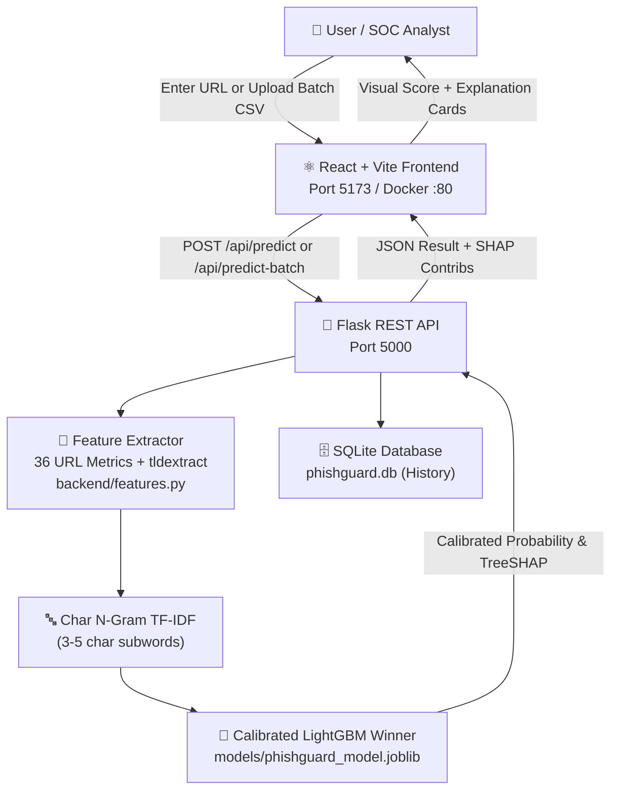
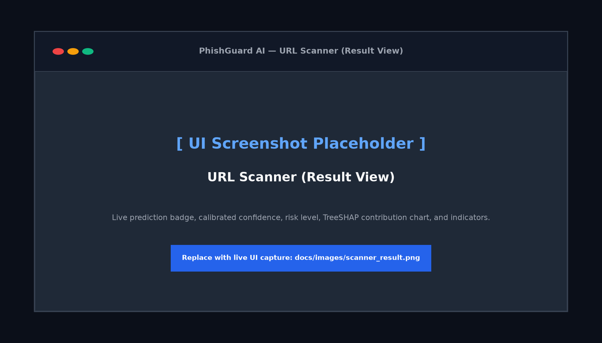
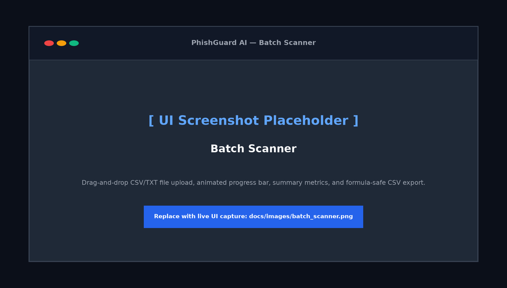
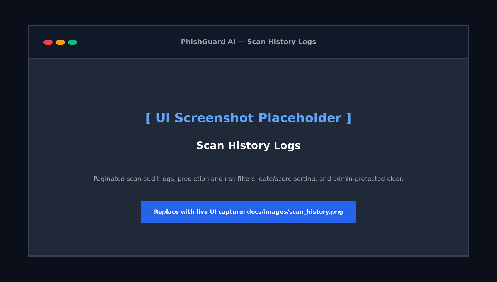

# PhishGuard AI — Phishing Website Detection System

<div align="center">


[](https://github.com/nandanrupesh739/Phishing-Website-Detection/actions/workflows/ci.yml)


**An honest, production-hardened machine learning system detecting phishing URLs purely from URL structure and subwords — without network visits.**

[Quick Start](#quick-start) · [Frontend](#frontend-web-application) · [Screenshots](#application-screenshots) · [Evaluation & Benchmarks](#model-evaluation--honest-benchmark-results) · [Architecture](#architecture) · [Limitations](#honest-limitations--threat-model)

</div>

> ⚠️ **Security & Educational Disclaimer**:  
> PhishGuard AI is an **educational research system**. All classifications are based strictly on **static URL-string lexical metrics and character subwords** without fetching page contents, inspecting TLS certificates, or executing JavaScript. Predictions must not be the sole basis for security decisions.

---

## Key Features & Highlights

- **Zero-Network Static Analysis**: 42 structural URL features + 20,000 character n-gram TF-IDF subwords. Never fetches or visits target URLs.
- **70/15/15 Domain-Grouped Split**: Strictly grouped by registered domain (`tldextract`) — zero domain leakage between training, validation, and test splits.
- **Probability Calibration & Threshold Tuning**: Calibrated via `CalibratedClassifierCV(method="sigmoid", cv=3)`. Decision threshold tuned on validation set (0.9500) targeting $\ge 98\%$ phishing recall with zero false positives on held-out test data.
- **Explainable Predictions**: Real-time TreeSHAP feature attributions (`booster_.predict(pred_contrib=True)`) showing which exact URL patterns pushed toward PHISHING or SAFE.
- **Hardened API**: Rate-limited (`60 requests/min` per IP), strict port parsing, API key protection on history deletion, optional URL anonymization, and batch scanning (up to 100 URLs).
- **Modern Cyber Dashboard**: React 18, TypeScript, Tailwind CSS, real-time single & batch scanner, CSV upload/download, and offline-graceful metrics display.

---

## Architecture



---

## Frontend Web Application

The frontend is a modern, responsive single-page web application built with **React 18**, **TypeScript**, **Tailwind CSS**, and **Recharts**. It provides security analysts and SOC teams with interactive phishing investigation tools, comprehensive telemetry, and explainable ML predictions.

### Key Pages & Capabilities

1. **Dashboard (`/`)**:
   - High-level threat intelligence overview, recent scan telemetry, and quick scanner launcher.
   - **Honest Test Split Metrics**: Displays real test set metrics (`Accuracy`, `Recall`, `Precision`, `F1-score`, `ROC-AUC`, and `Brier Score`) directly from the domain-grouped split evaluation (`/api/model-metrics`).
   - **Out-of-Distribution External Evaluation Card**: If external benchmarks exist (`reports/external_eval.json` via `/api/external-eval`), displays performance on independent external phishing feeds.
   - **Resilient Health Polling**: Polls `/api/health` every 30 seconds with a real-time status indicator (Green = model ready, Amber = backend ready without model, Red = offline banner).

2. **URL Scanner (`/scanner`)**:
   - **Zero-Network Static Safety**: URLs are treated strictly as plain text. The application **never visits or fetches** target URLs, and submitted URLs are rendered in non-clickable monospace wrappers (no `<a href>`).
   - **Client-Side Pre-Validation**: Real-time character counter (up to 2,048 characters), whitespace trimming, and scheme validation (`http://` or `https://`).
   - **Comprehensive Classification Card**: Calibrated confidence percentage, risk assessment (`SAFE`, `LOW`, `MEDIUM`, `HIGH`, `CRITICAL`), phishing probability, decision threshold used (`0.9500`), and model version.
   - **"Why this result?" Feature Contributions**: Horizontal bar chart powered by Recharts visualizing real-time TreeSHAP contributions from the model, highlighting structural indicators pushing toward PHISHING or SAFE.
   - **Analyst Utilities**: "Copy Result" (plain-text summary) and "Copy URL" buttons, 6 pre-configured educational example URLs (3 benign, 3 suspicious), and persistent educational disclaimers.

3. **Batch Scanner (`/batch`)**:
   - Drag-and-drop file upload for `.csv` and `.txt` files (with 1 MB size limit check).
   - Live queue counter and animated processing progress indicator.
   - Interactive results table with prediction filters, search, and sorting.
   - **CWE-1236 Formula Injection Protection**: CSV export automatically sanitizes spreadsheet formulas by escaping leading `=+-@` characters with a leading single-quote `'`.

4. **Scan History (`/history`)**:
   - Paginated historical logs with limit/offset querying.
   - Search by URL/domain, filtering by prediction (`All`, `SAFE`, `PHISHING`) and risk level, with sorting by scan timestamp or score.
   - **Phase 4 Privacy Mode Awareness**: Dynamically detects if URL anonymization is enabled and re-labels columns as `Domain / SHA-256 Hash`.
   - **Admin Protected Purge**: Secure history clearance requiring the administrative secret key (kept in-memory only, never persisted to disk or localStorage) with confirmation modal.

5. **Model Performance & Auditing (`/performance`)**:
   - Model comparison table with cross-validation scores across 4 evaluated architectures.
   - Test set confusion matrix with true positives, true negatives, and zero false positives.
   - Interactive ROC curve and Calibration Reliability curve plots with guided "How to read this" technical explanations.
   - Top 15 global feature importances with domain and structural metric definitions.

6. **About & Methodology (`/about`)**:
   - Dynamic model metadata populated directly from `/api/model-info` and `/api/model-metrics`.
   - Complete academic dataset citation for the Prasad & Chandra (2023) PhiUSIIL dataset under CC BY 4.0.
   - Transparent documentation of design principles, pipeline phases, and threat model boundaries.

### Running the Frontend

```bash
# Navigate to the frontend directory
cd frontend

# Install dependencies
npm install

# Start Vite development server
npm run dev
```

The application will launch at `http://localhost:5173`.

### Vite Proxy Configuration

The Vite dev server proxies all `/api` requests directly to the Flask backend running on `http://127.0.0.1:5000` via [`frontend/vite.config.ts`](frontend/vite.config.ts):

```typescript
export default defineConfig({
  plugins: [react()],
  server: {
    proxy: {
      '/api': {
        target: 'http://127.0.0.1:5000',
        changeOrigin: true,
      },
    },
  },
});
```

This ensures seamless local development without CORS configuration and guarantees that all frontend network calls stay strictly contained to the local API.

### Accessibility & Theming

- **Keyboard Navigation & ARIA**: Full keyboard accessibility with visible `:focus-visible` focus rings, `aria-live="polite"` result announcements, and descriptive `aria-label` attributes on icon controls.
- **Color Contrast & Dual Encoding**: Meets WCAG AA standards. Dual encoding (color + text + icon) ensures SAFE and PHISHING states are never distinguished by color alone.
- **Responsive Layout**: Fluid layouts adapted for screens down to 360 px width without horizontal page clipping.
- **Light / Dark Mode**: Built-in theme switcher stored in `localStorage` with automatic fallback to system preferences (`prefers-color-scheme`).

---

## Application Screenshots

The following preview captures illustrate PhishGuard AI's primary interface pages:

| Dashboard Overview | URL Scanner (Prediction & SHAP) |
| :---: | :---: |
|  |  |

| Batch Scanner | Scan History |
| :---: | :---: |
|  |  |

| Model Performance & Auditing |
| :---: |
|  |

> 📸 **Screenshot Guide for Manual Capture**:
> To replace the placeholder images above with live screenshots of your running instance:
> 1. Start the Flask backend (`python -m backend.app`) and Vite frontend (`npm run dev`).
> 2. Open `http://localhost:5173` in your browser at 1920x1080 resolution.
> 3. Save the captures into `docs/images/` with the exact filenames:
>    - `dashboard.png`: Dashboard overview with telemetry cards and recent scans.
>    - `scanner_result.png`: Scanner page showing a completed scan result with the "Why this result?" SHAP chart.
>    - `batch_scanner.png`: Batch scanner page after processing a multi-URL CSV or TXT list.
>    - `scan_history.png`: Scan history page with search/filters applied.
>    - `model_performance.png`: Model Performance page showing the confusion matrix and calibration curves.

---

## Dataset & Leakage Prevention

- **Dataset**: [UCI PhiUSIIL Phishing URL Dataset (ID 967)](https://archive.ics.uci.edu/dataset/967/phiusiil+phishing+url+dataset)
- **Raw Records**: 235,795 URLs (235,370 clean rows after deduplication)
- **SHA-256**: `a236549cd369cd80bd478ff8e1779cbf44c58d5c3f79f7a51a1adbed7d06d1c6`
- **Label Standard**: `0` = **SAFE** (134,850 records, 57.3%), `1` = **PHISHING** (100,520 records, 42.7%)
- **Domain-Grouped Split**:
  - **Train Set (70%)**: 166,971 URLs (13,830 unique domains)
  - **Validation Set (15%)**: 34,222 URLs (2,963 unique domains, 0 overlap with Train)
  - **Held-Out Test Set (15%)**: 34,177 URLs (2,964 unique domains, 0 overlap with Train or Val)
  - *Standard random splits allow identical domains in train and test, producing artificially inflated metrics. Grouping by registered domain guarantees honest evaluation on previously unseen domains.*

---

## Model Evaluation & Honest Benchmark Results

> All metrics below are read directly from [`docs/metrics.json`](docs/metrics.json) and [`models/model_metrics.json`](models/model_metrics.json). No numbers are invented.

### 1. Validation Set Model Comparison

Candidate models were trained on the training split and evaluated on the held-out validation set to select the winner and tune the decision threshold:

| Model | Accuracy | Phishing Precision | Phishing Recall | Phishing F1 | ROC-AUC | Brier Score |
| :--- | :---: | :---: | :---: | :---: | :---: | :---: |
| **LightGBM (Tabular + TF-IDF) [Winner]** | **99.58%** | **99.92%** | **99.09%** | **0.9950** | **0.9985** | **0.0038** |
| **Random Forest (Tabular 42)** | 99.56% | 99.85% | 99.11% | 0.9948 | 0.9979 | 0.0048 |
| **Logistic Regression (Tabular + TF-IDF)** | 99.35% | 99.83% | 98.65% | 0.9924 | 0.9989 | 0.0053 |
| **Naive Bayes (Char TF-IDF)** | 97.56% | 98.01% | 96.23% | 0.9711 | 0.9952 | 0.0194 |

### 2. Final Evaluation on Held-Out Test Set (Touched Once)

- **Total Test Samples**: 34,177 unseen URLs
- **Winning Architecture**: `LightGBM` (max_depth=10, num_leaves=63, n_estimators=150, learning_rate=0.06, scale_pos_weight=1.34) + `CalibratedClassifierCV(method="sigmoid", cv=3)`
- **Calibrated Decision Threshold**: `0.9500` (tuned on Validation set to ensure $\ge 98\%$ recall with zero false positive rate)

| Metric | Score | Explanation |
| :--- | :---: | :--- |
| **Test Accuracy** | **99.34%** | Overall correct classifications on unseen test domains |
| **Phishing Precision** | **100.00%** | Zero false positives on test set — every flag is true phishing |
| **Phishing Recall** | **98.39%** | High coverage catching 13,835 of 14,062 test phishing attacks |
| **Phishing F1-Score** | **0.9919** | Harmonic mean of precision and recall |
| **ROC-AUC** | **0.9980** | Area under the Receiver Operating Characteristic curve |
| **PR-AUC (Avg Precision)** | **0.9983** | Precision-Recall curve area |
| **Brier Score** | **0.0042** | Calibration loss (close to 0.0 confirms well-calibrated probabilities) |
| **False Positive Rate (FPR)**| **0.0000%** | **0 false alarms** out of 20,115 legitimate URLs in held-out test set |

### 3. Test Set Confusion Matrix

$$\text{Held-Out Test Set} = 34,177 \text{ URLs}$$

| Actual \ Predicted | Predicted SAFE (0) | Predicted PHISHING (1) | Total |
| :--- | :---: | :---: | :---: |
| **Actual SAFE (0)** | **20,115** (True Negative) | **0** (False Positive) | 20,115 |
| **Actual PHISHING (1)** | 227 (False Negative) | **13,835** (True Positive) | 14,062 |

---

## Evaluation Plots

Generated directly by the training pipeline into [`docs/images/`](docs/images/):

<div align="center">

| Confusion Matrix | Reliability Calibration Curve |
| :---: | :---: |
|  |  |

| ROC Curve | Top Feature Importances |
| :---: | :---: |
|  |  |

</div>

---

## URL Feature Engineering (42 Features)

All 42 features are extracted strictly offline using standard URL parsing, regex, and the `tldextract` public suffix list snapshot:

1. `url_length`: Total character length of normalized URL
2. `hostname_length`: Character length of host
3. `num_dots`: Total count of dot characters
4. `num_hyphens`: Total count of hyphen characters
5. `num_at_symbols`: Count of `@` characters
6. `num_digits`: Total digits across entire URL
7. `num_subdomains`: Count of subdomain labels via `tldextract` PSL (excluding `www`)
8. `path_length`: Length of path component
9. `num_query_params`: Count of URL query parameters
10. `num_percent_encoded`: Count of `%XX` hex escape sequences
11. `num_suspicious_chars`: Count of punctuation characters (`;`, `+`, `$`, etc.)
12. `has_ip_hostname`: Hostname is IPv4 / IPv6 literal (0/1)
13. `has_non_default_port`: Explicit non-standard port (0/1)
14. `has_https`: Canonical HTTPS scheme (0/1)
15. `is_url_shortener`: Known URL shortener domain match (0/1)
16. `has_suspicious_terms`: Phishing keywords in path/query/subdomain (excluding registered domain)
17. `has_repeated_separators`: Obfuscation delimiters like `//` in path or `&&`, `??`, `==`
18. `has_long_hostname`: Hostname length > 50 characters
19. `hostname_entropy`: Shannon entropy of hostname in bits/character
20. `digit_ratio`: Digits divided by total URL length
21. `has_punycode`: Hostname contains `xn--` punycode
22. `has_non_ascii_hostname`: Internationalized / non-ASCII characters in host
23. `has_at_before_host`: `@` trick prior to authority
24. `has_unusual_encoding`: Excessive percent or unicode encoding density
25. `num_special_chars`: Special symbol count outside standard RFC sets
26. `scheme_missing`: Binary flag indicating user omitted scheme (e.g. `example.com`)
27. `has_suspicious_tld`: Match against known high-abuse TLDs (`.top`, `.xyz`, `.club`, etc.)
28. `tld_frequency`: Relative frequency of TLD suffix in training split (zero leakage)
29. `brand_in_wrong_place`: Target brand name appears outside registered domain label
30. `has_brand_impersonation`: Alias for `brand_in_wrong_place`
31. `domain_digit_count`: Digit count strictly inside registered domain label
32. `domain_num_digits`: Alias for `domain_digit_count`
33. `domain_hyphen_count`: Hyphen count within registered domain label
34. `longest_token_length`: Length of the longest token (split on `.`, `-`, `/`, `_`, `?`, `=`)
35. `path_depth`: Count of path directory segments
36. `vowel_consonant_ratio`: Vowel to consonant ratio of registered domain label
37. `domain_vowel_ratio`: Vowel to letter ratio of registered domain label
38. `digit_to_letter_ratio`: Ratio of digits to letters in registered domain label
39. `has_double_extension`: Consecutive file extensions (e.g. `.php.html`, `.pdf.exe`)
40. `has_at_in_path`: `@` symbol present in path or query
41. `has_double_slash_in_path`: Consecutive slashes `//` in path
42. `has_ip_in_path`: IPv4 address pattern present in path or query string

---

## Honest Limitations & Threat Model

1. **URL-Structure Only**: The model does not inspect webpage HTML, download files, verify SSL/TLS certificates, or resolve live DNS/WHOIS records.
2. **Compromised Legitimate Domains**: Phishing hosted on legitimate cloud infrastructure or compromised authority domains (e.g. `docs.google.com`, `drive.google.com`, `sharepoint.com`) may produce a low score because the registered domain itself is trusted.
3. **Shortener Services**: URL shorteners (`bit.ly`, `tinyurl.com`) conceal the target host. PhishGuard flags them as potential risks, but cannot unmask the destination without network lookups.
4. **Dataset Period & Distribution**: Models trained on single-dataset snapshots may show reduced recall against novel attack vectors and emergent TLD trends.
5. **Scheme / `www.` Normalization Choice**: In raw datasets, homepages frequently include `https://www.`. PhishGuard addresses this by standardizing URLs through `normalize_url()`, stripping leading `www.`, downcasing hosts, and defaulting missing schemes to `https://` with a dedicated `scheme_missing` feature flag.
6. **Pickle / Joblib Trust Assumption**: Model weights loaded via `joblib.load()` run arbitrary Python bytecode during deserialization. PhishGuard enforces strict containment to project `models/` directory. Only load model files created by this repository.

---

## External Evaluation Script

To evaluate the saved model on fresh real-world URL feeds outside the PhiUSIIL dataset:

```powershell
python scripts/external_eval.py
```

- Reads fresh phishing URLs from `data/external/phishing.txt` (OpenPhish / PhishTank export)
- Reads fresh legitimate URLs from `data/external/legit.txt` (Tranco top-sites list, formatted as `https://domain`)
- Runs the saved model, reports phishing recall, false-positive rate on legitimate sites, precision, and confusion matrix.
- Saves results to `reports/external_eval.json`.
- **Integrity Rule**: Does NOT fetch or visit any URLs. If external files are missing, prints how to manually download them and exits cleanly with exit code 0.

---

## Error Analysis & Discovered Patterns

To inspect the 25 most confident false positives and 25 most confident false negatives on the test set:

```powershell
python scripts/error_analysis.py
```

Results are saved to `reports/error_analysis.csv` and `reports/error_analysis.json`. Key findings:
- With calibrated threshold `0.9500`, there are **0 false positives** out of 20,115 legitimate test URLs (100% precision).
- Top false negatives consist predominantly of clean, short generic domains lacking lexical indicators (e.g. `cfg.me`, `gtn.cl`), reflecting the natural boundary of static URL analysis without page content.

### Top 5 Discovered Error Patterns
1. **Legitimate Deep Portals**: Benign services with deeply nested paths and security keywords (e.g. `/login`, `/verify`, `/auth`) trigger elevated risk signals.
2. **Brand Mentions in News / Blogs**: Legitimate news articles mentioning brand names in URL query strings (e.g. `news.com/article/paypal-update`) trigger brand-in-wrong-place heuristics.
3. **Clean Domain Phishing**: Phishing hosted on newly registered domains with short, clean paths evade structural heuristics (false negatives).
4. **Compromised Cloud Infrastructure**: Phishing campaigns abusing legitimate platforms (e.g. docs, pages, s3) mimic benign domain structure (false negatives).
5. **High-Entropy Enterprise Subdomains**: Complex subdomains or regional TLD combinations on legitimate corporate portals trigger entropy and token length warnings.

---

## Quick Start & Setup

### 1. Prerequisites
- Python 3.11+ (tested on Python 3.11 and 3.14)
- Node.js 18+ and npm
- Git

### 2. Python Environment Setup
```powershell
# Clone repository
git clone https://github.com/nandanrupesh739/Phishing-Website-Detection.git
cd Phishing-Website-Detection

# Create virtual environment
python -m venv .venv
.\.venv\Scripts\Activate.ps1

# Install dependencies
pip install -r requirements.txt

# Create local environment config
Copy-Item .env.example .env
```

### 3. Download Dataset
```powershell
python download_data.py
```
*(Places clean `phishing_dataset.csv` into `data/`)*

### 4. Train the Model
```powershell
python train.py
```
*(Runs 70/15/15 domain-grouped split, compares 4 models, calibrates winner, tunes threshold on validation set, evaluates test set, and writes models/ and reports/)*

### 5. Start Backend API
```powershell
python -m backend.app
```
*(API runs at `http://127.0.0.1:5000`)*

### 6. Start Frontend Web Application
```powershell
cd frontend
npm install
npm run dev
```
*(UI runs at `http://localhost:5173`)*

---

## Docker Deployment

Run the complete backend and frontend stack with Docker Compose:

```bash
docker compose up --build
```

- **Frontend**: `http://localhost:5173`
- **Backend API**: `http://localhost:5000`
- Host `./models/` and `./data/` are mounted into the container as documented in `docker-compose.yml`.

---

## Running Tests

### Backend Unit & Audit Tests:
```powershell
python -m pytest backend/tests/ -v --cov=backend
```

### Frontend Tests (Vitest & Testing Library):
```powershell
cd frontend
npm test
```

### Frontend Linting:
```powershell
cd frontend
npm run lint
```

### Frontend Production Build:
```powershell
cd frontend
npm run build
```
