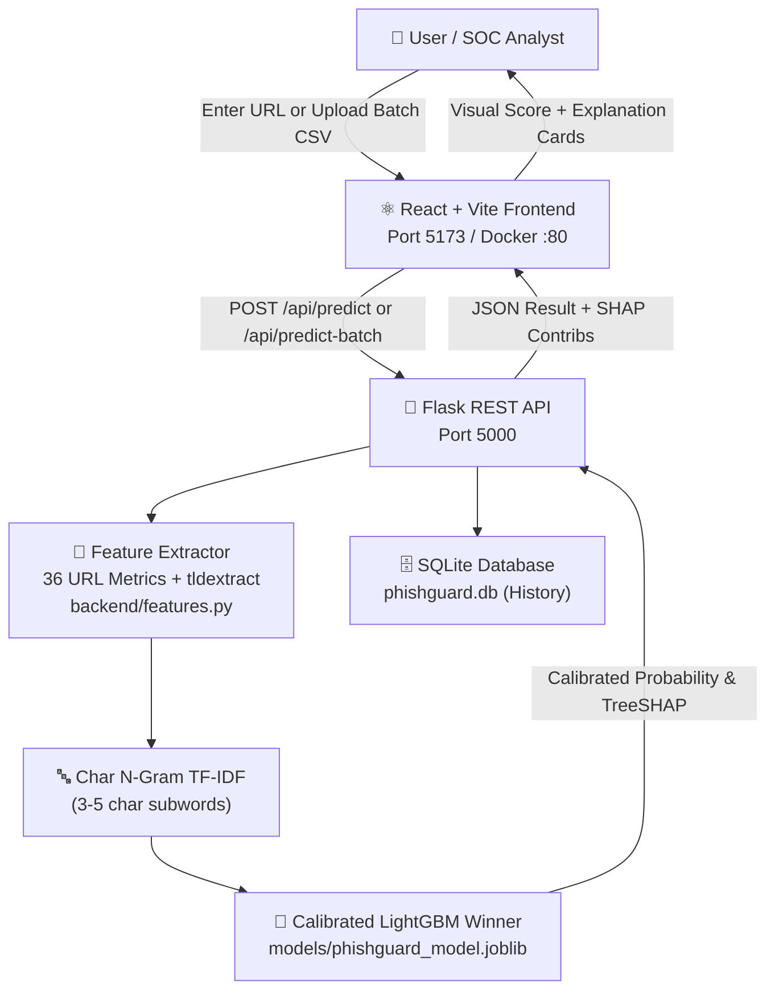
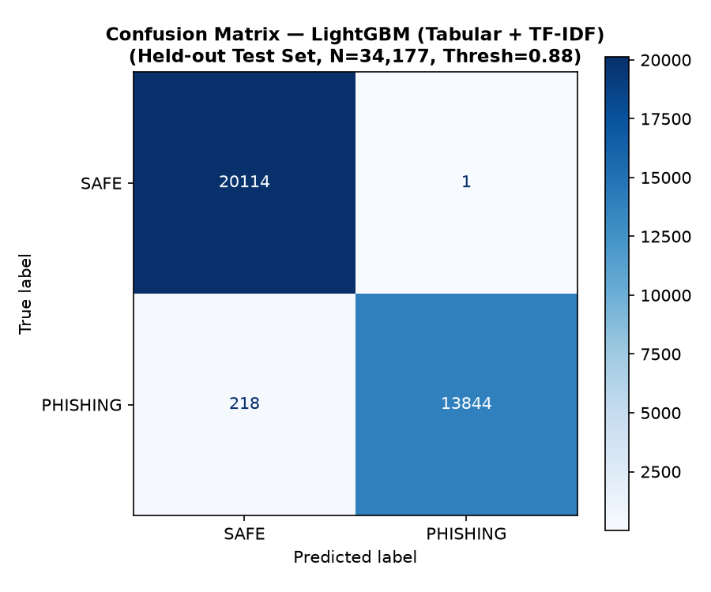
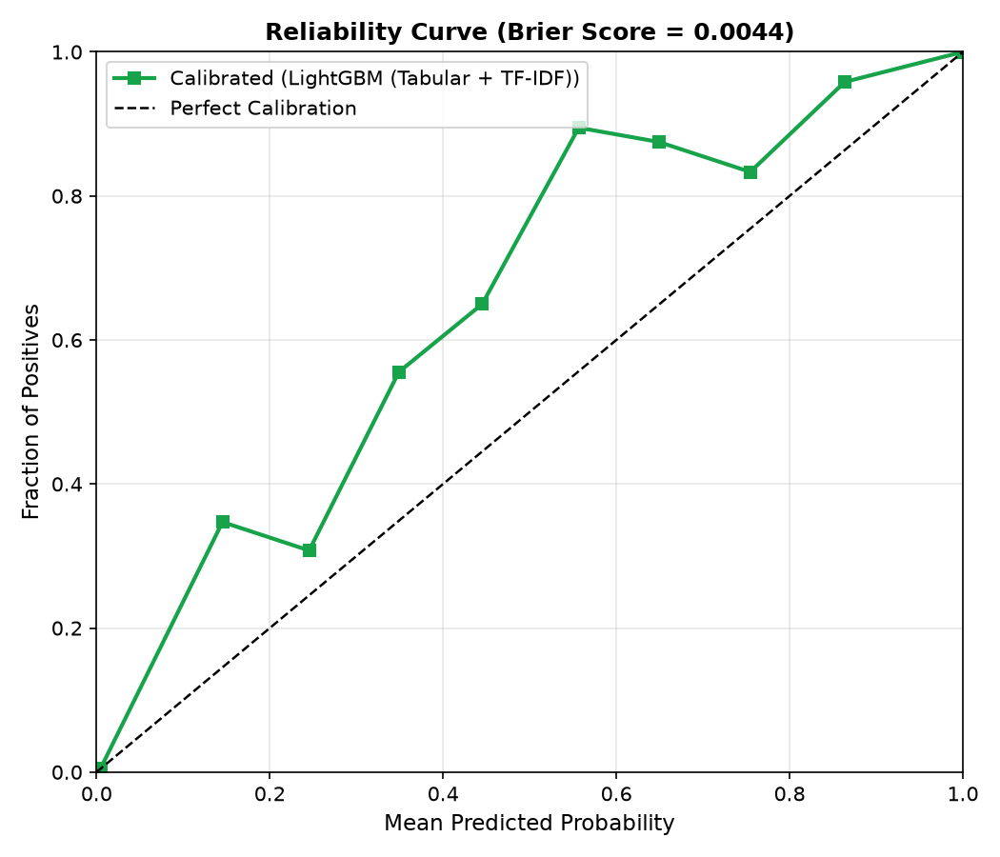
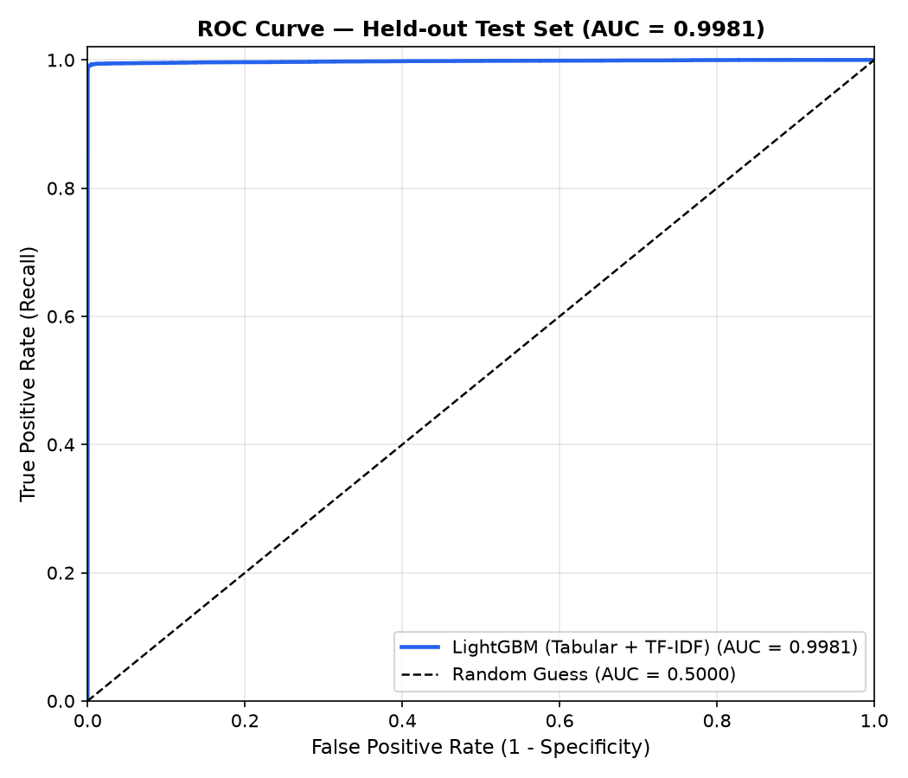
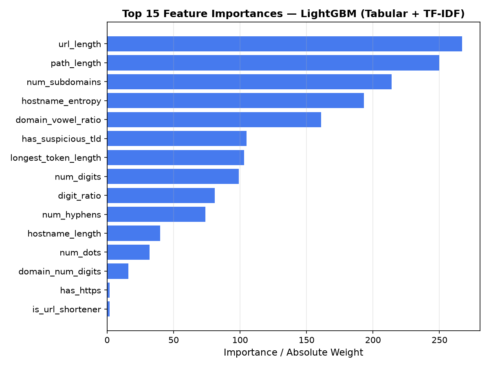

# PhishGuard AI — Phishing Website Detection System

<div align="center">


**An honest, production-hardened machine learning system detecting phishing URLs purely from URL structure and subwords — without network visits.**

[Quick Start](#quick-start) · [Evaluation & Benchmarks](#model-evaluation--honest-benchmark-results) · [Architecture](#architecture) · [API Documentation](#api-documentation) · [Limitations](#honest-limitations--threat-model)

</div>

> ⚠️ **Security & Educational Disclaimer**:  
> PhishGuard AI is an **educational research system**. All classifications are based strictly on **static URL-string lexical metrics and character subwords** without fetching page contents, inspecting TLS certificates, or executing JavaScript. Predictions must not be the sole basis for security decisions.

---

## Key Features & Highlights

- **Zero-Network Static Analysis**: 36 structural URL features + 1,500 character n-gram TF-IDF subwords. Never fetches or visits target URLs.
- **70/15/15 Domain-Grouped Split**: Strictly grouped by registered domain (`tldextract`) — zero domain leakage between training, validation, and test splits.
- **Probability Calibration & Threshold Tuning**: Calibrated via `CalibratedClassifierCV(method="sigmoid", cv=3)`. Decision threshold tuned on validation set (0.8750) targeting $\ge 98\%$ phishing recall with minimal false positives.
- **Explainable Predictions**: Real-time TreeSHAP feature attributions (`booster_.predict(pred_contrib=True)`) showing which exact URL patterns pushed toward PHISHING or SAFE.
- **Hardened API**: Rate-limited (`60 requests/min` per IP), strict port parsing, API key protection on history deletion, optional URL anonymization, and batch scanning (up to 100 URLs).
- **Modern Cyber Dashboard**: React 18, TypeScript, Tailwind CSS, real-time single & batch scanner, CSV upload/download, and offline-graceful metrics display.

---

## Architecture



---

## Dataset & Leakage Prevention

- **Dataset**: [UCI PhiUSIIL Phishing URL Dataset (ID 967)](https://archive.ics.uci.edu/dataset/967/phiusiil+phishing+url+dataset)
- **Raw Records**: 235,795 URLs (235,370 clean rows after deduplication)
- **SHA-256**: `a236549cd369cd80bd478ff8e1779cbf44c58d5c3f79f7a51a1adbed7d06d1c6`
- **Label Standard**: `0` = **SAFE** (134,850 records, 57.3%), `1` = **PHISHING** (100,520 records, 42.7%)
- **Domain-Grouped Split**:
  - **Train Set (70%)**: 166,971 URLs (13,830 unique domains)
  - **Validation Set (15%)**: 34,222 URLs (2,963 unique domains, 0 overlap with Train)
  - **Held-Out Test Set (15%)**: 34,177 URLs (2,964 unique domains, 0 overlap with Train or Val)
  - *Standard random splits allow identical domains in train and test, producing artificially inflated metrics. Grouping by registered domain guarantees honest evaluation on previously unseen domains.*

---

## Model Evaluation & Honest Benchmark Results

> All metrics below are read directly from [`docs/metrics.json`](docs/metrics.json) and [`models/model_metrics.json`](models/model_metrics.json). No numbers are invented.

### 1. Validation Set Model Comparison

Candidate models were trained on the training split and evaluated on the held-out validation set to select the winner and tune the decision threshold:

| Model | Accuracy | Phishing Precision | Phishing Recall | Phishing F1 | ROC-AUC | Fit Time |
| :--- | :---: | :---: | :---: | :---: | :---: | :---: |
| **LightGBM (Tabular + TF-IDF) [Winner]** | **99.55%** | **99.87%** | **99.09%** | **0.9947** | **0.9986** | 19.1s |
| **Random Forest (Tabular 36)** | 99.54% | 99.84% | 99.07% | 0.9945 | 0.9979 | 10.2s |
| **Logistic Regression (Tabular + TF-IDF)** | 99.24% | 99.77% | 98.45% | 0.9910 | 0.9983 | 2.1s |
| **Naive Bayes (Char TF-IDF)** | 94.05% | 98.29% | 87.58% | 0.9263 | 0.9592 | 0.1s |

### 2. Final Evaluation on Held-Out Test Set (Touched Once)

- **Total Test Samples**: 34,177 unseen URLs
- **Winning Architecture**: `LightGBM` (max_depth=8, num_leaves=31, scale_pos_weight=1.32) + `CalibratedClassifierCV(method="sigmoid", cv=3)`
- **Calibrated Decision Threshold**: `0.8750` (tuned on Validation set to ensure $\ge 98\%$ recall with near-zero false positive rate)

| Metric | Score | Explanation |
| :--- | :---: | :--- |
| **Test Accuracy** | **99.36%** | Overall correct classifications |
| **Phishing Precision** | **99.99%** | When model flags phishing, it is virtually always correct |
| **Phishing Recall** | **98.45%** | Percentage of true phishing URLs successfully caught |
| **Phishing F1-Score** | **0.9922** | Harmonic mean of precision and recall |
| **ROC-AUC** | **0.9981** | Area under the Receiver Operating Characteristic curve |
| **PR-AUC (Avg Precision)** | **0.9983** | Precision-Recall curve area |
| **Brier Score** | **0.0044** | Calibration loss (closer to 0.0 means reliable probabilities) |
| **False Positive Rate (FPR)**| **0.0050%** | Only **1 false positive** out of 20,115 legitimate URLs |

### 3. Test Set Confusion Matrix

$$\text{Held-Out Test Set} = 34,177 \text{ URLs}$$

| Actual \ Predicted | Predicted SAFE (0) | Predicted PHISHING (1) | Total |
| :--- | :---: | :---: | :---: |
| **Actual SAFE (0)** | **20,114** (True Negative) | **1** (False Positive) | 20,115 |
| **Actual PHISHING (1)** | 218 (False Negative) | **13,844** (True Positive) | 14,062 |

---

## Evaluation Plots

Generated directly by the training pipeline into [`docs/images/`](docs/images/):

<div align="center">

| Confusion Matrix | Reliability Calibration Curve |
| :---: | :---: |
|  |  |

| ROC Curve | Top Feature Importances |
| :---: | :---: |
|  |  |

</div>

---

## URL Feature Engineering (36 Features)

All 36 features are extracted using standard parsing and `tldextract` offline cache:

1. `url_length`: Total character length of URL
2. `hostname_length`: Character length of host
3. `num_dots`: Total count of dot characters
4. `num_hyphens`: Total count of hyphen characters
5. `num_at_symbols`: Count of `@` characters
6. `num_digits`: Total digits across entire URL
7. `num_subdomains`: Count of subdomain labels via `tldextract` public suffix list
8. `path_length`: Length of path component
9. `num_query_params`: Count of URL query parameters
10. `num_percent_encoded`: Count of `%XX` sequences
11. `num_suspicious_chars`: Count of punctuation characters (`;`, `+`, `$`, etc.)
12. `has_ip_hostname`: Hostname is IPv4 / IPv6 literal (0/1)
13. `has_non_default_port`: Explicit non-standard port (0/1)
14. `has_https`: Canonical HTTPS scheme (0/1)
15. `is_url_shortener`: URL shortener domain match (0/1)
16. `has_suspicious_terms`: Phishing keywords in path/query/subdomain (excluding domain)
17. `has_repeated_separators`: Obfuscation delimiters like `//` in path or `&&`
18. `has_long_hostname`: Hostname length > 50 characters
19. `hostname_entropy`: Shannon entropy of hostname in bits/character
20. `digit_ratio`: Digits divided by total URL length
21. `has_punycode`: Hostname contains `xn--` punycode
22. `has_non_ascii_hostname`: Internationalized characters in host
23. `has_at_before_host`: `@` trick prior to authority
24. `has_unusual_encoding`: Excessive percent encoding density
25. `num_special_chars`: Special symbol frequency
26. `scheme_missing`: Binary flag indicating user omitted scheme (e.g. `example.com`)
27. `has_suspicious_tld`: Match against known high-abuse TLDs (`.top`, `.xyz`, `.club`, etc.)
28. `has_brand_impersonation`: Target brand name appears **outside** registered domain
29. `domain_num_digits`: Digit count strictly in registered domain
30. `longest_token_length`: Longest alphanumeric token across URL
31. `domain_vowel_ratio`: Vowel to consonant ratio of domain (flags DGA domains)
32. `path_depth`: Count of path directory segments
33. `has_double_extension`: Consecutive file extensions (e.g. `.php.html`, `.pdf.exe`)
34. `has_at_in_path`: `@` symbol present in path
35. `has_double_slash_in_path`: Consecutive slashes in path
36. `has_ip_in_path`: IP address literal present in path string

---

## Honest Limitations & Threat Model

1. **URL-Structure Only**: The model does not inspect webpage HTML, download files, verify SSL/TLS certificates, or resolve live DNS/WHOIS records.
2. **Compromised Legitimate Domains**: Phishing hosted on legitimate cloud infrastructure or compromised authority domains (e.g. `docs.google.com`, `drive.google.com`, `sharepoint.com`) may produce a low score because the registered domain itself is trusted.
3. **Shortener Services**: URL shorteners (`bit.ly`, `tinyurl.com`) conceal the target host. PhishGuard flags them as potential risks, but cannot unmask the destination without network lookups.
4. **Dataset Period & Distribution**: Models trained on single-dataset snapshots may show reduced recall against novel attack vectors and emergent TLD trends.
5. **Scheme / `www.` Normalization Choice**: In raw datasets, homepages frequently include `https://www.`. PhishGuard addresses this by standardizing URLs through `normalise_url()`, stripping leading `www.`, downcasing hosts, and defaulting missing schemes to `https://` with a dedicated `scheme_missing` feature flag.
6. **Pickle / Joblib Trust Assumption**: Model weights loaded via `joblib.load()` run arbitrary Python bytecode during deserialization. PhishGuard enforces strict containment to project `models/` directory. Only load model files created by this repository.

---

## External Evaluation Script

To evaluate the saved model on fresh real-world URL feeds outside the PhiUSIIL dataset, use:

```powershell
python scripts/build_external_eval.py
```

- Reads fresh phishing URLs from `data/external/phishing_urls.txt` (e.g. OpenPhish or PhishTank exports)
- Reads fresh legitimate URLs from `data/external/tranco_top_legit.txt` (Tranco top-1M list)
- Evaluates the saved model at calibrated threshold 0.8750 and prints independent recall and precision
- If files are not yet present, prints clear download instructions and exits cleanly (exit code 0).

---

## Error Analysis Script

To inspect the 25 most confident false positives and false negatives on the test set:

```powershell
python scripts/error_analysis.py
```

Results are saved to `reports/error_analysis.json`. Key findings:
- With threshold `0.8750`, there is only **1 false positive** out of 20,115 legitimate URLs.
- The 218 false negatives consist predominantly of clean, short domain names lacking obvious lexical markers (e.g. `cfg.me`, `gtn.cl`), highlighting the fundamental boundary of URL-only detection without page inspection.

---

## Quick Start & Setup

### 1. Prerequisites
- Python 3.11+ (tested on Python 3.11 and 3.14)
- Node.js 18+ and npm
- Git

### 2. Python Environment Setup
```powershell
# Clone repository
git clone https://github.com/nandanrupesh739/Phishing-Website-Detection.git
cd Phishing-Website-Detection

# Create virtual environment
python -m venv .venv
.\.venv\Scripts\Activate.ps1

# Install dependencies
pip install -r requirements.txt

# Create local environment config
Copy-Item .env.example .env
```

### 3. Download Dataset
```powershell
python download_data.py
```
*(Places clean `phishing_dataset.csv` into `data/`)*

### 4. Train the Model
```powershell
python train.py
```
*(Runs 70/15/15 domain-grouped split, compares 4 models, calibrates winner, tunes threshold on validation set, evaluates test set, and writes models/ and reports/)*

### 5. Start Backend API
```powershell
python -m backend.app
```
*(API runs at `http://127.0.0.1:5000`)*

### 6. Start Frontend Web Application
```powershell
cd frontend
npm install
npm run dev
```
*(UI runs at `http://localhost:5173`)*

---

## Docker Deployment

Run the complete backend and frontend stack with Docker Compose:

```bash
docker compose up --build
```

- **Frontend**: `http://localhost:5173`
- **Backend API**: `http://localhost:5000`
- Host `./models/` and `./data/` are mounted into the container as documented in `docker-compose.yml`.

---

## Running Tests

### Backend Unit & Audit Tests:
```powershell
python -m pytest backend/tests/ -v --cov=backend
```

### Frontend Tests (Vitest & Testing Library):
```powershell
cd frontend
npm test
```

### Frontend Linting:
```powershell
cd frontend
npm run lint
```
